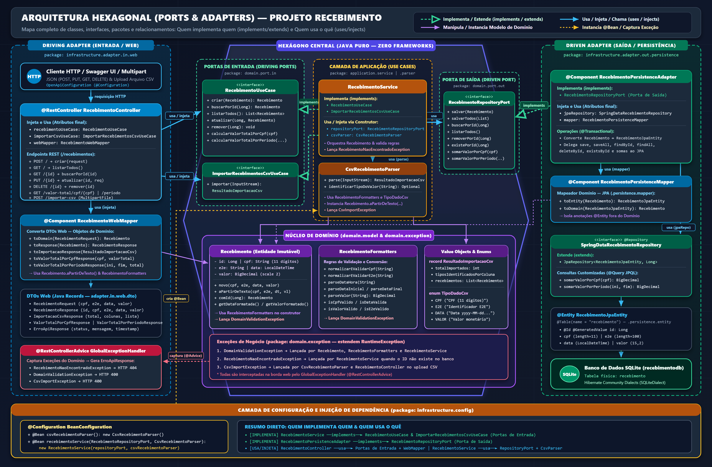
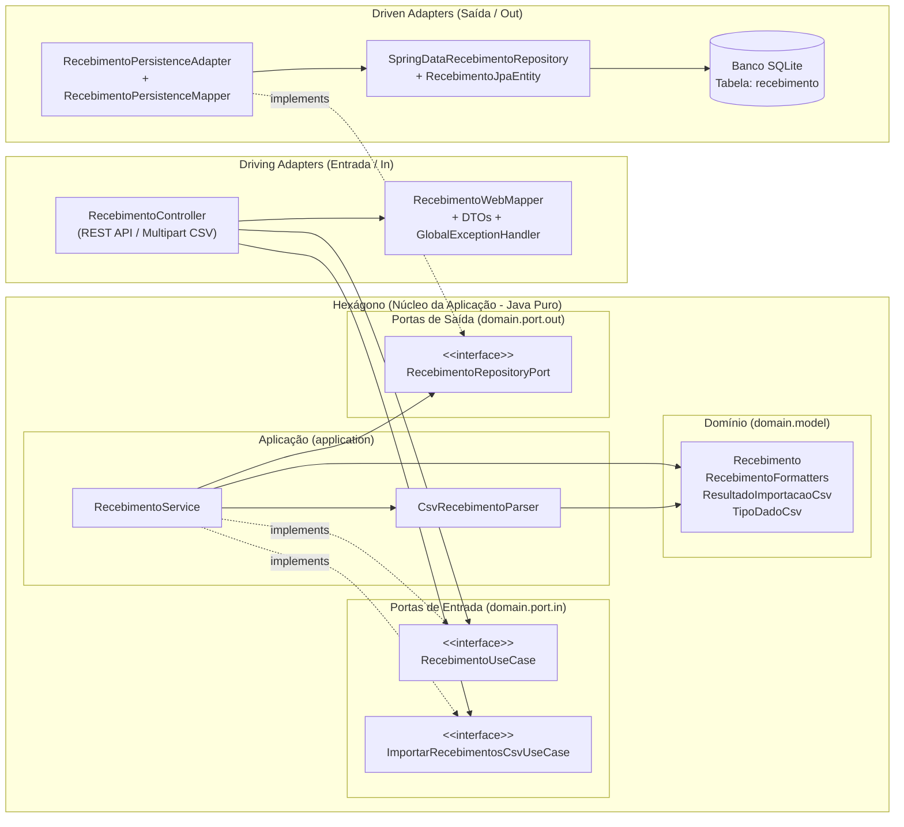
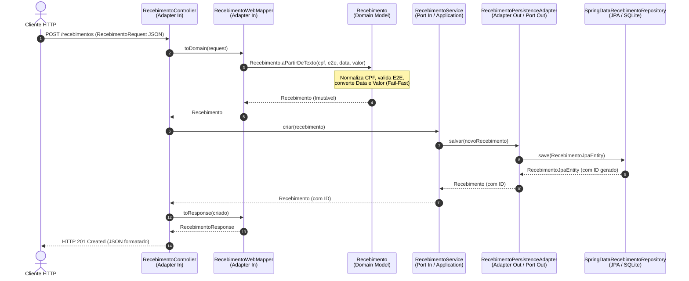

# Arquitetura Hexagonal (Ports & Adapters) e Clean Code no Projeto Recebimento

Este documento explica detalhadamente como a **Arquitetura Hexagonal (Ports and Adapters)** e as práticas de **Clean Code (Código Limpo)** e **SOLID** foram aplicadas na construção da API de Recebimentos.

---

## Sumário

1. [Visão Geral da Arquitetura Hexagonal](#1-visão-geral-da-arquitetura-hexagonal)
2. [Estrutura de Pacotes do Projeto](#2-estrutura-de-pacotes-do-projeto)
3. [Camadas, Portas e Adaptadores no Código](#3-camadas-portas-e-adaptadores-no-código)
   - [3.1. Núcleo de Domínio (`domain`)](#31-núcleo-de-domínio-domain)
   - [3.2. Camada de Aplicação (`application`)](#32-camada-de-aplicação-application)
   - [3.3. Camada de Infraestrutura (`infrastructure`)](#33-camada-de-infraestrutura-infrastructure)
4. [Fluxo de Execução Ponta a Ponta](#4-fluxo-de-execução-ponta-a-ponta)
5. [Práticas de Clean Code e SOLID Aplicadas](#5-práticas-de-clean-code-e-solid-aplicadas)
   - [5.1. Domínio Rico, Imutabilidade e Invariantes (Fail-Fast)](#51-domínio-rico-imutabilidade-e-invariantes-fail-fast)
   - [5.2. Factory Methods Semânticos e Records](#52-factory-methods-semânticos-e-records)
   - [5.3. Métodos Pequenos e Nomes Reveladores de Intenção](#53-métodos-pequenos-e-nomes-reveladores-de-intenção)
   - [5.4. Princípio da Responsabilidade Única (SRP) e Separação de Modelos](#54-princípio-da-responsabilidade-única-srp-e-separação-de-modelos)
   - [5.5. Inversão de Dependência (DIP) e Domínio Agnóstico a Frameworks](#55-inversão-de-dependência-dip-e-domínio-agnóstico-a-frameworks)
   - [5.6. Tratamento Limpo e Centralizado de Exceções](#56-tratamento-limpo-e-centralizado-de-exceções)
6. [Impacto na Testabilidade](#6-impacto-na-testabilidade)

---

## 1. Visão Geral da Arquitetura Hexagonal

Proposta por Alistair Cockburn, a **Arquitetura Hexagonal** (ou **Ports and Adapters**) tem como objetivo principal **proteger as regras de negócio (Domínio e Aplicação)** de detalhes técnicos externos, como frameworks web (Spring MVC), bancos de dados (SQLite / JPA / Hibernate) e formatos de transporte (JSON, Multipart, Swagger).

A regra fundamental de dependência neste projeto é:

> **As dependências apontam sempre de fora (Infraestrutura) para dentro (Domínio).** O Domínio não conhece o Spring Boot, o banco SQLite, nem a camada Web.





---

## 2. Estrutura de Pacotes do Projeto

A organização de pacotes reflete diretamente os limites arquiteturais do hexágono:

```text
com.fontecode.recebimento.recebimento
├── domain                              # NÚCLEO DE NEGÓCIO (Java Puro, zero frameworks)
│   ├── exception                       # Exceções de negócio e validação
│   │   ├── CsvImportException.java
│   │   ├── DomainValidationException.java
│   │   └── RecebimentoNaoEncontradoException.java
│   ├── model                           # Entidades de domínio, Value Objects e regras
│   │   ├── Recebimento.java
│   │   ├── RecebimentoFormatters.java
│   │   ├── ResultadoImportacaoCsv.java
│   │   └── TipoDadoCsv.java
│   └── port                            # Contratos (Interfaces) de entrada e saída
│       ├── in                          # Driving Ports (Casos de Uso expostos)
│       │   ├── ImportarRecebimentosCsvUseCase.java
│       │   └── RecebimentoUseCase.java
│       └── out                         # Driven Ports (Dependências externas exigidas)
│           └── RecebimentoRepositoryPort.java
│
├── application                         # ORQUESTRAÇÃO DOS CASOS DE USO (Java Puro)
│   ├── parser
│   │   └── CsvRecebimentoParser.java   # Identificação automática de colunas e parse de CSV
│   └── service
│       └── RecebimentoService.java     # Implementação das Portas de Entrada (Use Cases)
│
└── infrastructure                      # ADAPTADORES E CONFIGURAÇÃO DE FRAMEWORKS (Spring/JPA)
    ├── adapter
    │   ├── in.web                      # Adaptador Primário (Entrada via HTTP/REST)
    │   │   ├── RecebimentoController.java
    │   │   ├── dto                     # Objetos de transferência da API (JSON)
    │   │   ├── exception               # Tradução de exceções de domínio para HTTP
    │   │   └── mapper                  # Conversão DTO <-> Domínio
    │   └── out.persistence             # Adaptador Secundário (Saída para Banco de Dados)
    │       ├── RecebimentoPersistenceAdapter.java
    │       ├── entity                  # Entidade JPA mapeada para a tabela 'recebimento'
    │       ├── mapper                  # Conversão Domínio <-> Entidade JPA
    │       └── repository              # Interface Spring Data JPA
    └── config                          # Injeção de Dependência e Configurações Técnicas
        ├── BeanConfiguration.java
        └── OpenApiConfiguration.java
```

---

## 3. Camadas, Portas e Adaptadores no Código

### 3.1. Núcleo de Domínio (`domain`)

O pacote `domain` concentra as regras de negócio puras da aplicação:

- **Modelo de Domínio (`Recebimento`)**: Representa um recebimento válido no negócio (`id`, `cpf`, `e2e`, `data`, `valor`). Não possui anotações `@Entity` ou `@Table`. Garante que nenhum objeto `Recebimento` exista em memória com CPF inválido, valor negativo ou data nula.
- **Regras de Formatação e Validação (`RecebimentoFormatters`)**: Centraliza as regras de validação e normalização exigidas pelo negócio:
  - CPF: aceita 11 dígitos ou máscara `000.000.000-00` e normaliza para apenas números.
  - E2E: valida identificadores alfanuméricos.
  - Data: valida e formata no padrão `yyyy-MM-dd HH:mm:ss` (e permite datas `yyyy-MM-dd` nos filtros de período).
  - Valor: interpreta valores no formato brasileiro `999990,99` e garante escala de 2 casas decimais (`RoundingMode.HALF_UP`).
- **Portas de Entrada (`domain.port.in`)**:
  - `RecebimentoUseCase`: Define o contrato de negócio para o CRUD (`criar`, `buscarPorId`, `listarTodos`, `atualizar`, `remover`) e consultas agregadas (`calcularValorTotalPorCpf`, `calcularValorTotalPorPeriodo`).
  - `ImportarRecebimentosCsvUseCase`: Define o contrato para importação de fluxos de dados CSV (`importar(InputStream)`).
- **Porta de Saída (`domain.port.out`)**:
  - `RecebimentoRepositoryPort`: Define o que o domínio precisa que o mecanismo de persistência faça (`salvar`, `salvarTodos`, `buscarPorId`, `listarTodos`, `removerPorId`, `existePorId`, `somarValorPorCpf`, `somarValorPorPeriodo`), sem acoplamento com SQL ou JPA.

### 3.2. Camada de Aplicação (`application`)

A camada de aplicação coordena o fluxo dos casos de uso implementando as portas de entrada e acionando as portas de saída:

- **`RecebimentoService`**: Implementa `RecebimentoUseCase` e `ImportarRecebimentosCsvUseCase`. Ele valida pré-condições de negócio (como verificar se `dataInicial` não é posterior à `dataFinal` ou se o registro existe antes de atualizar/remover) e delega a persistência à interface `RecebimentoRepositoryPort`.
- **`CsvRecebimentoParser`**: Responsável pela inteligência de leitura do CSV. Ele inspeciona cada coluna da linha, detecta automaticamente o delimitador (`;` ou `,`), identifica se há cabeçalho e descobre dinamicamente qual coluna representa `CPF`, `E2E`, `DATA` e `VALOR` (independentemente da ordem das colunas no arquivo).

### 3.3. Camada de Infraestrutura (`infrastructure`)

Contém os adaptadores que conectam o mundo externo ao hexágono:

1. **Driving Adapter (Adaptador de Entrada Web - `adapter.in.web`)**:
   - **Quem inicia a ação**: O cliente HTTP (usuário, frontend ou Swagger).
   - `RecebimentoController` recebe requisições HTTP (`RecebimentoRequest` ou `MultipartFile`), usa o `RecebimentoWebMapper` para converter os dados para objetos de domínio e chama as portas de entrada (`RecebimentoUseCase` / `ImportarRecebimentosCsvUseCase`).
2. **Driven Adapter (Adaptador de Saída de Persistência - `adapter.out.persistence`)**:
   - **Quem inicia a ação**: O núcleo da aplicação (via `RecebimentoRepositoryPort`).
   - `RecebimentoPersistenceAdapter` implementa `RecebimentoRepositoryPort`. Ele converte o objeto de domínio `Recebimento` para `RecebimentoJpaEntity` (usando `RecebimentoPersistenceMapper`) e utiliza o `SpringDataRecebimentoRepository` para gravar ou consultar a tabela `recebimento` no banco SQLite.
3. **Configuração e Wiring (`infrastructure.config.BeanConfiguration`)**:
   - Como `RecebimentoService` e `CsvRecebimentoParser` não possuem anotações do Spring (`@Service` ou `@Component`) para manter o núcleo limpo, a classe `BeanConfiguration` instancia esses objetos como `@Bean` e injeta a implementação da porta de saída (`RecebimentoRepositoryPort`).

---

## 4. Fluxo de Execução Ponta a Ponta

O diagrama de sequência abaixo ilustra como uma requisição de **Criação de Recebimento (`POST /recebimentos`)** atravessa as camadas respeitando o isolamento arquitetural:



---

## 5. Práticas de Clean Code e SOLID Aplicadas

Além da separação estrutural da Arquitetura Hexagonal, o código segue princípios rigorosos de **Clean Code** (Robert C. Martin) e **SOLID**.

### 5.1. Domínio Rico, Imutabilidade e Invariantes (Fail-Fast)

Em vez de usar um *Modelo Anêmico* (classes cheias de `getters` e `setters` sem validação, onde qualquer parte do sistema pode alterar o estado para um valor inválido), a classe `Recebimento` implementa:

- **Imutabilidade**: Todos os campos são `private final` (`id`, `cpf`, `e2e`, `data`, `valor`) e não existem métodos `set`.
- **Autovalidação no Construtor (Fail-Fast)**: Um `Recebimento` valida e normaliza todos os seus dados no momento em que é instanciado:

```java
public Recebimento(Long id, String cpf, String e2e, LocalDateTime data, BigDecimal valor) {
    this.id = id;
    this.cpf = RecebimentoFormatters.normalizarEValidarCpf(cpf);
    this.e2e = RecebimentoFormatters.normalizarEValidarE2e(e2e);
    this.data = validarData(data);
    this.valor = validarValor(valor);
}
```

Se qualquer dado estiver incorreto, uma `DomainValidationException` é lançada imediatamente, garantindo que o restante do sistema nunca precise lidar com objetos corrompidos.

### 5.2. Factory Methods Semânticos e Records

Em vez de sobrecarregar construtores confusos, a classe `Recebimento` oferece métodos fábrica estáticos com nomes expressivos:

- `Recebimento.novo(cpf, e2e, data, valor)`: Deixa explícito que o recebimento ainda não possui `id`.
- `Recebimento.aPartirDeTexto(cpf, e2e, dataTexto, valorTexto)`: Encapsula o parse de strings brutas vindas da Web ou do CSV.
- `recebimento.comId(novoId)`: Como a entidade é imutável, cria uma nova instância preservando o estado validado e associando o identificador requerido na atualização.

Além disso, todos os DTOs (`RecebimentoRequest`, `RecebimentoResponse`, `ImportacaoCsvResponse`, `ValorTotalPorCpfResponse`, `ValorTotalPorPeriodoResponse`, `ErroApiResponse`) e objetos de resultado (`ResultadoImportacaoCsv`) utilizam **`record` do Java 17**, eliminando código repetitivo (*boilerplate*) e reforçando a imutabilidade no transporte de dados.

### 5.3. Métodos Pequenos e Nomes Reveladores de Intenção

Um dos pilares do Clean Code é que o código deve ser lido como uma prosa bem escrita, sem necessidade de comentários para explicar *o que* ele está fazendo.

No `CsvRecebimentoParser`, por exemplo, um problema complexo (ler CSV com ou sem cabeçalho, separado por `;` ou `,`, onde o próprio valor decimal possui vírgula `999990,99` e as colunas podem vir em qualquer ordem) foi decomposto em métodos curtos, coesos e com nomes autoexplicativos:

- `lerLinhasNaoVazias(inputStream)`
- `removerBomUtf8(linha)`
- `isLinhaCabecalho(tokensPrimeiraLinha)`
- `tokenizarLinha(linha)`
- `detectarDelimitador(linha)`
- `separarRespeitandoAspas(linha, delimitador)`
- `recomporValorDecimalComVirgulaSeNecessario(tokensBrutos)`
- `identificarTiposNaLinha(tokens, nomesColunas, ...)`
- `identificarTipoDoValor(valorBruto)`

Não há "números mágicos" soltos no código: constantes nomeadas como `QUANTIDADE_CAMPOS_ESPERADA = 4` e expressões regulares pré-compiladas (`CPF_DIGITS_PATTERN`, `VALOR_BR_PATTERN`, `DATA_FORMATTER`) deixam a intenção clara e otimizam a performance.

### 5.4. Princípio da Responsabilidade Única (SRP) e Separação de Modelos

Cada classe no projeto tem **apenas um motivo para mudar**:

| Classe | Responsabilidade Única | Motivo para Mudar |
| :--- | :--- | :--- |
| `Recebimento` | Regras e estado de um recebimento | Mudança nas regras de negócio do recebimento |
| `CsvRecebimentoParser` | Interpretação e inferência de tipos do CSV | Mudança no layout ou regras de leitura do arquivo CSV |
| `RecebimentoService` | Orquestração dos casos de uso | Mudança no fluxo de negócio do CRUD ou agregações |
| `RecebimentoController` | Exposição HTTP/REST e documentação OpenAPI | Mudança nos endpoints, rotas ou status HTTP |
| `RecebimentoJpaEntity` | Mapeamento objeto-relacional (ORM) | Mudança na estrutura da tabela `recebimento` no banco |
| `RecebimentoWebMapper` | Conversão entre DTOs Web e Domínio | Mudança no formato JSON da API |
| `RecebimentoPersistenceMapper` | Conversão entre Domínio e Entidade JPA | Mudança no esquema de persistência |

Note como o projeto **não reutiliza a mesma classe** como `@Entity` do banco, modelo de domínio e DTO JSON da API. Isso evita que uma alteração na tabela do banco quebre o contrato JSON da API ou contamine as regras de negócio.

### 5.5. Inversão de Dependência (DIP) e Domínio Agnóstico a Frameworks

Seguindo o **D** do SOLID (*Dependency Inversion Principle*):
- Módulos de alto nível (`RecebimentoService`) não dependem de módulos de baixo nível (`RecebimentoPersistenceAdapter` ou `SpringDataRecebimentoRepository`). Ambos dependem da abstração `RecebimentoRepositoryPort`, que pertence ao pacote `domain.port.out`.
- O pacote `domain` e o pacote `application` importam exclusivamente pacotes da biblioteca padrão do Java (`java.math.*`, `java.time.*`, `java.util.*`, `java.io.*`). Se amanhã o banco SQLite for substituído por PostgreSQL, MongoDB ou uma chamada a uma API externa, **nenhuma linha de código** nos pacotes `domain` e `application` precisará ser modificada.

### 5.6. Tratamento Limpo e Centralizado de Exceções

Em vez de retornar códigos de erro ou poluir o `RecebimentoController` com blocos `try/catch` em todos os endpoints, o projeto utiliza exceções de domínio semânticas:

- `DomainValidationException` → Dados de entrada violam regras do domínio (ex.: CPF inválido, data inicial maior que data final, valor negativo).
- `CsvImportException` → Problemas estruturais ou de validação durante a importação de arquivo CSV.
- `RecebimentoNaoEncontradoException` → Busca, atualização ou remoção de um ID inexistente.

O adaptador web `GlobalExceptionHandler` (`@RestControllerAdvice`) intercepta essas exceções e as traduz automaticamente em respostas padronizadas (`ErroApiResponse`) com os códigos HTTP adequados (`400 Bad Request` ou `404 Not Found`).

---

## 6. Impacto na Testabilidade

A combinação de Arquitetura Hexagonal e Clean Code reflete diretamente na suíte de testes do projeto:

1. **Testes Unitários Rápidos e Independentes de Framework (`CsvRecebimentoParserTest`)**:
   - Como o `CsvRecebimentoParser` e o modelo `Recebimento` são classes Java puras sem acoplamento com o Spring, os testes unitários instanciam `new CsvRecebimentoParser()` diretamente e executam em milissegundos, validando múltiplos cenários de CSV (colunas fora de ordem, sem cabeçalho, valores inteiros, dados inválidos) sem precisar subir banco de dados ou contexto web.
2. **Testes de Integração Ponta a Ponta (`RecebimentoControllerIntegrationTest`)**:
   - Exercitam o fluxo completo desde o adaptador de entrada (`RecebimentoController`), passando pelos casos de uso (`RecebimentoService`), até o adaptador de saída (`RecebimentoPersistenceAdapter`) e verificam a persistência real na tabela `recebimento` do banco SQLite.
